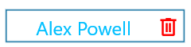

# Players

The **Players** page contains the master player list used by CourtZ.

This is the master record of every player. Session Profiles refer to players in this list rather than storing their own copies.

Because there is only one record for each player, changes such as updating a player's name or Skill Level are automatically reflected wherever that player is used.

If you're organising a one-off session, you can also add guest players directly to a session without adding them to the master player list.

*Selecting a group updates the filter badge and the player count to show the matching players.*

---

## Creating a Player

To add a player:

1. Open the **Players** page.
2. Select the &#xe7fe; icon.
3. Enter the player's name.
4. Select **Male** or **Female**.
5. Set the player's Skill Level.
6. Under **Groups / clubs**, select any groups the player belongs to. To make a new group, enter its name and select **Add**, then select the new group.
7. Select **Add** to save the player.

The player is now available for use in any Session Profile or session.

---

## Groups and Clubs

Players can belong to one or more groups or clubs. Assign these while creating or editing a player, or manage the group names from **Options** (⋮) on the Players page. For example, a player who plays badminton and pickleball can belong to both **Shuttle Sparks** and **Kitchen Crew**.

On the Players page, select the filter icon &#xef4f; to show the group checkboxes. Its blue badge shows how many groups are selected, and the player count and list update to match. In a player-selection popup, use the same filter icon beside the search field. Select one or more groups to include players who belong to **any** selected group. Search text and group filters work together. With no groups selected, all players remain available. The **No group** filter is available on the Players page for finding players who have not been assigned to a group.

## Skill Levels

Each player has a Skill Level between **0** and **10**.

* **0** represents a beginner.
* **10** represents an expert player.

CourtZ uses Skill Levels when generating balanced games. They don't need to be exact—choose a value that reasonably reflects the player's current playing ability.

As players improve, you can update their Skill Level at any time.

Player cards are colour-coded to provide a quick visual indication of ability:

* 🟢 Beginner
* 🔵 Intermediate
* 🔴 Expert

---

## Editing Players

Player details can be updated whenever required.

Typical reasons for editing a player include:

* correcting a name
* changing a Skill Level
* changing the player's group or club memberships

Because Session Profiles refer to the master player list, any changes you make are automatically available wherever that player is used.

The editor shows the player's current group memberships. Select or clear groups, then save the changes.

*A player can be assigned to more than one group or club.*

---

To manage groups:

1. Open the **Players** page.
2. Select **Options** (⋮).
3. Select **Manage Groups**.
4. Add a group, or select **Rename** or **Delete** beside an existing group.
5. Select **Done** to save your changes.

Renaming a group updates the membership for every player assigned to it. Deleting a group removes that group from its players; it does not delete the players themselves.

A player who belongs to multiple selected groups appears only once in the filtered results.

### Filtering in the Select Players popup

When adding players to a session or the Waiting Room, select the filter icon &#xef4f; beside the search field to show the group options. The search field and group filters work together, so you can narrow the list by name and by group. Select one or more groups to include players from any of them, then tap the player cards to add players. The popup stays open while you make several selections; select **Done** when you have finished. The two columns continue to separate male and female players.

*Use the filter icon to show group choices. The player list keeps male and female players in separate columns.*

---

## Deleting Players

To help prevent accidental deletion, players are deleted using a two-step process.

To delete a player:

1. Tap and hold the player's name.
2. A red bin icon &#xE872; appears beside the player's name.
3. Tap the red bin icon within **3 seconds**.

*Tap and hold a player's name to reveal the red bin icon. Select it within 3 seconds to delete the player.*

If the red bin icon is not selected within **3 seconds**, it disappears and the player is not deleted.

If the player belongs to one or more Session Profiles, CourtZ automatically removes the player from those profiles.

---

## Additional Options

Select **Options** (⋮) to access additional actions for the Players page.

**Delete ALL Players** permanently removes every player from the master player list.

Use this option with care, as it cannot be undone.

---

## Tips

> **Tip:** Don't worry about assigning perfect Skill Levels. They are intended as a guide for game generation and can be adjusted over time as players improve or as you become more familiar with their playing ability.

---

## Related Topics

* [Session Profiles](03-session-profiles.md)
* [Running a Session](04-running-a-session.md)
* [Game Generation](05-game-generation.md)

---

← [Getting Started](01-getting-started.md) | [🏠 Help Home](00-index.md) | [Session Profiles →](03-session-profiles.md)

