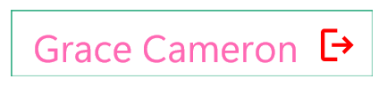

# Game Generation

Game Generation is at the heart of CourtZ.

The first round of games is generated automatically when a session starts. After each round of play, select + to generate the next round.

---

## Generating the First Games

When you select **Start Session**, CourtZ automatically generates the first round of games using the current Session Profile settings and the players attending today's session.

Players are allocated to courts and any remaining players are placed in the Waiting Room.

*The Games page showing four waiting players, four courts, the countdown timer and one change available to Undo at the right of the session selector strip.*

Players can now move to their allocated courts and begin play.

If you are using the optional Countdown Timer, start it before play begins. An alarm sounds automatically when the selected game duration has elapsed.

---

## Generating the Next Round

When the current round has finished, select the + icon to generate the next round.

CourtZ automatically:

- selects the players for the next round
- allocates players to courts
- updates the Waiting Room
- applies any player availability changes

CourtZ calculates the allocation automatically using the current session settings. You can then adjust the latest round by swapping players; see [Manual Round Adjustments](#manual-round-adjustments).

Players can then move to their allocated courts and begin the next round.

Repeat this process until the session has finished.

---

## Viewing Previous Rounds

CourtZ keeps a complete history of every round generated during the current session.

Use the navigation controls above the Games panel to move backwards and forwards through previous rounds.

- &lt; displays the previous round.
- &gt; moves forwards through existing rounds.
- + generates the next round or regenerates the current round after editing the previous round.

Previous rounds show the recorded court allocations and Waiting Room for that round, including any manual adjustments made while it was the latest round. Manual swaps are available only on the latest round.

You can adjust player availability on the immediately previous round as explained below. Earlier rounds are read-only.

---

## Editing the Previous Round

When reviewing previous rounds, only the immediately previous round allows changes to attendance or next-round availability. Its court allocations cannot be rearranged.

This allows you to correct changes that occurred during the current round, such as:

- a player leaving the session
- a player resting after the current game
- a late-arriving player joining the session
- adding a guest player

After making changes, the + icon regenerates the current round using the updated player list.

Earlier rounds are read-only and cannot be modified.

---

## Regenerating the Current Round

After editing the previous round, the + icon changes from generating the next round to regenerating the current round.

Regeneration replaces the current round using the updated player list.

A warning is displayed before the previous round is edited to remind you that any games already in progress should be allowed to finish before regenerating.

---

## How Game Generation Works

Each time a new round is generated, CourtZ evaluates the available players and attempts to produce the best possible set of games using the current session settings.

Rather than applying a single rule, CourtZ balances a number of factors, including:

- player Skill Levels
- previous partnerships
- previous opponents
- mixed games preferences
- player waiting time
- Expected Games

The importance of each factor depends on the current session settings. For example, **Balanced** Team Skills attempts to produce evenly matched teams by keeping the total Skill Levels of each side as close as possible, while **Competitive** Team Skills attempts to group players of similar ability together.

### Expected Games

Players can optionally specify the number of games they expect to play when attendance is prepared.

When a player has an Expected Games target, CourtZ gives them additional priority during game generation to help them reach that target.

Once a player reaches their expected number of games, you can choose to remove them before generating the next round.

No two sessions are exactly alike, so the generated games may vary as player attendance changes throughout the session.

The aim is to produce enjoyable, varied and fair games while ensuring that everyone receives regular opportunities to play.

---

## The Waiting Room

The Waiting Room is managed automatically throughout the session.

As each new round is generated, players move between the courts and the Waiting Room.

If there are more players than available court spaces, some players remain in the Waiting Room until they can be included in a later round.

---

## Players Joining or Leaving

You can add players during a session and adjust availability before generating the next round. Immediate removal from the Waiting Room is available while viewing the latest round.

For example, you can:

- add a late-arriving player to the Waiting Room
- add a guest player
- remove a player who leaves the session

Any changes are automatically taken into account the next time the + icon is selected.

When adding existing players, use **Select Players** to move names from **Available** into **Added**. Select **Done** to add them to the Waiting Room, or **Cancel** to discard the selection. See [Selecting Players](02-players.md#selecting-players).

---

### Removing a Player from the Waiting Room

1. Tap the player's name in the Waiting Room.
2. Choose **Leave session**.
3. Confirm the removal.

Players on court can choose **Leave after this round**, allowing them to finish their current game without leaving an empty court position.

Removing a player from the Waiting Room affects only the current session. The player remains in the master player list and in any Session Profiles to which they belong.

---

## Player Availability

Before generating the next round, you can indicate whether players wish to continue playing.

### Players currently on court

Tap a player to open the player menu:

- **Rest next round** – the player completes the current game, then sits out the next round.
- **Leave after this round** – the player completes the current game, then leaves the session and is not included in subsequent rounds.

To reverse a rest request, choose **Play next round**. To reverse a departure request, choose **Carry on playing**.

*Players on court can be marked to rest after their current game or to leave the session.*

### Players in the Waiting Room

Tap a player in the Waiting Room to open their menu.

- **Rest next round** – the player skips the next round and remains in the Waiting Room.
- **Play next round** – reverses a rest request so the player is available for selection.
- **Leave session** – removes the player from the current session after confirmation.

The menu shows the options applicable to the player's current status.

*A Waiting Room player can swap with someone on court, request a rest, or leave the session after confirmation.*

---

## Manual Round Adjustments

In a Play Session, you can adjust the latest round by dragging one player onto another to swap them. You can swap with an opponent, someone on another court, or someone in the Waiting Room. A player's current partner and empty spaces are not swap targets.

Alternatively, tap the player, choose **Swap player**, then tap the other player. Select **Cancel swap** if you change your mind.

To reach players off screen while dragging on Android or Windows, hold near the top or bottom edge of the scrolling area.

If a player marked **Rest next round** is swapped off court into the Waiting Room, their rest request clears and they are eligible for the next round. If they were marked **Leave after this round**, they leave the session immediately instead. The incoming player fills their court position.

CourtZ uses the final adjusted round when updating partnership, opponent and sit-out history for the next round. Manual swapping is available for Play Sessions, not tournament draws.

### Undoing Changes

The blue **Undo** icon and count appear at the right of the session selector strip when there are changes to undo. This strip stays visible while you scroll through the courts.

Each tap reverses one swap, status change or removal. A status Undo restores the previous status. Undoing a swap that removed a departing player also restores that player's attendance and leave flag.

You can reverse successive changes throughout the current round. Starting a new round clears its Undo history.

---

## Saving the Current Session

If you would like to reuse the current session in the future, select **Save Session** from the **Options** menu (⋮).

This saves the current players and game settings as a Session Profile, allowing the same setup to be used again in future sessions.

---

## What's Next?

The current session settings can be changed at any time using **Session Settings** from the **Options** menu (⋮). These changes affect future games generated during the current session only and do not modify the original Session Profile.

Continue to **Games Display** to learn how to present court allocations to players, or **Countdown Timer** to learn how to use the optional timer.

---

← [Running a Session](04-running-a-session.md) | [🏠 Help Home](00-index.md) | [Games Display →](06-display-games.md)
