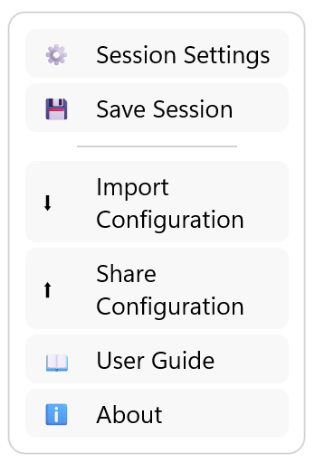
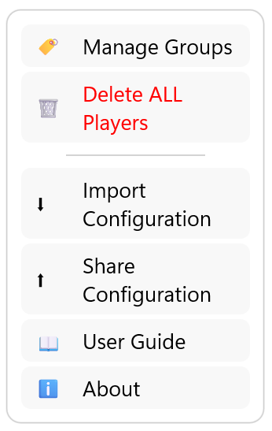
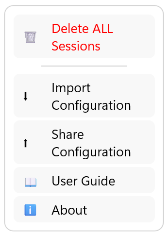
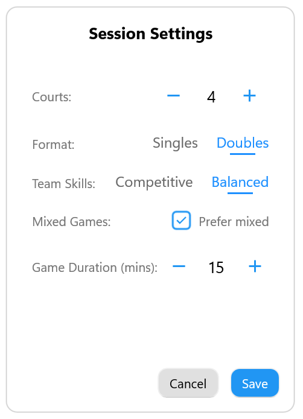

# Options

The **Options** menu (⋮) changes depending on which tab is open. The tab-specific actions appear first; **Import Configuration**, **Share Configuration**, **User Guide** and **About** are available from every tab.

Select **Options** (⋮) on the tab you want to manage. The examples show the different tab-specific actions:

  <figure>
    <figcaption>Games</figcaption>
    
  </figure>
  <figure>
    <figcaption>Players</figcaption>
    
  </figure>
  <figure>
    <figcaption>Sessions</figcaption>
    
  </figure>

## What the menu items do

**Games**

- **Session Settings** – change settings such as courts, format and game duration for the current session. [Read more](#session-settings).
- **Save Session** – save the current setup as a Session Profile. [Read more](#save-session).

**Players**

- **Manage Groups** – add, rename or delete player groups. See [Groups and Clubs on the Players page](02-players.md#groups-and-clubs).
- **Delete ALL Players** – permanently remove every player from the master player list.

**Sessions**

- **Delete ALL Sessions** – permanently delete every Session Profile.

**Available from every tab**

- **Import Configuration** – load players, Session Profiles and settings from a configuration file. [Read more](09-configuration.md#importing-a-configuration).
- **Share Configuration** – export or share all data or selected Session Profiles. [Read more](09-configuration.md#sharing-a-configuration).
- **User Guide** – open the CourtZ Help website.
- **About** – view the app version, club and licence details.

---

## Session Settings

Select **Session Settings** to temporarily change the game generation settings for the current session.

Session Profiles provide the default settings for a session. Once play has started, you can override those settings using **Session Settings**.

Depending on your session, you can change settings such as:

- number of courts
- game duration
- Singles or Doubles
- Team Skills
- mixed games preferences

The updated settings are used in the next round when the + icon is selected.

These changes affect only the current session. They do not modify the original Session Profile.

*Session Settings allows the game generation settings for the current session to be adjusted.*

---

## Save Session

Select **Save Session** to save the current session as a Session Profile.

You can:

- create a new Session Profile
- overwrite an existing Session Profile

This is useful if you started a session without using a Session Profile, or if you have adjusted the current session and would like to use the same setup again.

---

## Import Configuration

Select **Import Configuration** to import a previously exported CourtZ configuration.

A configuration can contain:

- players
- Session Profiles
- application settings

When importing a configuration, you can choose how the imported data is applied:

- **Replace** – replaces the current configuration with the imported configuration.
- **Merge** – combines the imported configuration with the existing data.
- **Selected Profiles** – imports only selected Session Profiles and the players required by those profiles.

When configurations are merged, imported data is combined with the existing CourtZ configuration.

CourtZ validates imported files and reports an error if the file is not a valid CourtZ configuration.

---

## Export or Share Configuration

CourtZ allows configuration data to be transferred to another device or saved as a backup.

On desktop devices, select **Export Configuration** to save the configuration to a file.

On mobile devices, select **Share Configuration** to share the configuration using the device's standard sharing options.

You can export or share:

- the complete configuration
- selected Session Profiles

When selected Session Profiles are exported or shared, the players required by those profiles are included automatically.

Configuration data can be used to:

- create a backup
- transfer CourtZ data to another device
- share a club configuration with another organiser

Configuration files use a standard JSON format, making them easier to transfer between supported platforms.

---

## User Guide

Select **User Guide** from the **Options** menu (⋮) to open the CourtZ Help website.

The online help includes:

- getting started guides
- explanations of CourtZ features
- step-by-step instructions
- troubleshooting information
- the latest documentation for new releases

An internet connection is required to access the online help.

---

## About

Select **About** to view information about your copy of CourtZ.

The About dialog displays:

- CourtZ version
- club name
- email address
- licence status
- licence type
- issue date (licensed copies)
- expiry date (where applicable)

If you are using the trial version, you can also activate your purchased licence from the About dialog.

The About dialog also provides access to the CourtZ website.

---

## Tips

> **Tip:** Temporary changes made using **Session Settings** affect only the current session. To make permanent changes, edit the Session Profile instead.

> **Tip:** Regularly exporting your configuration provides a convenient backup of your players, Session Profiles and application settings.

---

## What's Next?

Continue to **Configuration** to learn about the application settings.

---

← [Countdown Timer](07-countdown-timer.md) | [🏠 Help Home](00-index.md) | [Configuration →](09-configuration.md)
