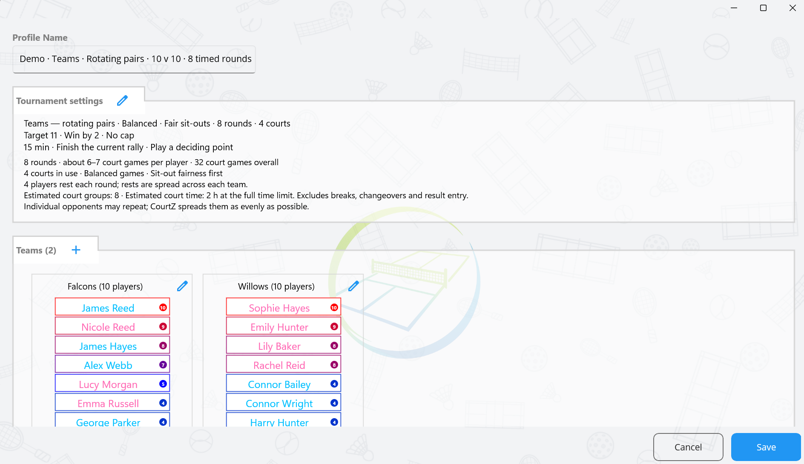
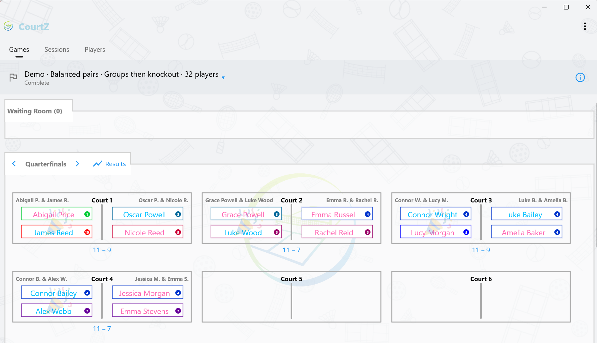

# Tournament Mode

Tournament mode runs competitions with recorded results, standings and draws. You can run singles, fixed-pair doubles or team events, save progress and return to an event later.

Tournament mode is available from **CourtZ 4.0.0** onwards. This guide describes **4.1.1**. Earlier versions, including **3.5.4**, support Play Sessions without tournament mode. See [Download CourtZ](../download.html) for the available versions.

## In this guide

- [Quick start](#quick-start)
- [Choose who competes](#choose-who-competes)
- [Choose a tournament format](#choose-a-tournament-format)
- [Create and edit a profile](#create-and-edit-a-profile)
- [Create fixed pairs](#create-fixed-pairs)
- [Set up team events](#set-up-team-events)
- [Scoring and time limits](#scoring-and-time-limits)
- [Plan the playing time](#plan-the-playing-time)
- [Prepare attendance and start](#prepare-attendance-and-start)
- [Run rounds and record results](#run-rounds-and-record-results)
- [Understand standings and winners](#understand-standings-and-winners)
- [Replace or withdraw a player](#replace-or-withdraw-a-player)
- [Resume and share](#resume-and-share)
- [Example: 32 players, eight courts, two hours](#example-32-players-eight-courts-two-hours)
- [Common questions](#common-questions)

## Quick start

1. Add your players on **Players**, including their Skill Levels if you want balanced pairings.
2. On **Sessions**, select **+** beside **Tournaments**.
3. Name the profile, choose who competes, and set the format, courts, scoring and time limit.
4. Add the players, pairs or teams. Check the workload estimate, then **Save** the profile.
5. On **Games**, open the session selector and choose the tournament profile.
6. Confirm attendance and select **Start tournament**.
7. Play the displayed games, enter each **Result**, and use the forward arrow when the current court group is complete.
8. Open **Results** to review the draw, standings and winner, or share a results image.

## Choose who competes

An **entrant** is the unit that competes in the draw: one player, one fixed pair or one team. For example, 32 players in fixed pairs means **16 entrants**.

| Choice | How it works |
|---|---|
| **Individuals — singles** | One player on each side. Results belong to the individual. |
| **Fixed pairs — doubles** | Two players form one entrant and stay together throughout the event. |
| **Teams → Team encounters** | Teams contest a specified number of singles and doubles games against each other. Court-game results decide the team encounter. |
| **Teams → Rotating pairs** | Exactly two teams play doubles with changing partners. CourtZ spreads sit-outs and tries to limit repeated partnerships and opponents. |

**Individuals — rotating partners** is listed in the settings but cannot start in this release. For supported rotating doubles within a tournament, use **Teams → Rotating pairs** with two teams.

For a regular club session where players change partners without tournament standings, see [Running a Session](04-running-a-session.md).

## Choose a tournament format

| Format | Who plays next? | Useful when… |
|---|---|---|
| **Round robin** | Each entrant plays every other entrant. Standings decide the finishing order. | You want everyone to meet everyone and have time for the full schedule. |
| **Knockout** | Winners advance; one loss eliminates an entrant. | You want a direct route to a final and accept that an entrant can finish after one game. |
| **Double elimination** | Entrants continue after their first loss; a second loss eliminates them. | You want a second chance and can allow for a longer, variable schedule. |
| **Groups then knockout** | Entrants play a round robin within their group; the top finishers qualify for knockout. | You want several opening games followed by semifinals or a final. |
| **Swiss** | A fixed number of rounds, with later opponents matched as closely as possible by standings. | You want several competitive rounds without playing every other entrant. |

**Teams → Rotating pairs** uses its own round-based schedule and overall team totals. Choose its number of rounds rather than a knockout or Swiss format.

### Groups, qualifiers and byes

For **Groups then knockout**, set the number of groups and the number qualifying from each. Groups are drawn at random. Each group needs at least two entrants, and the number qualifying cannot exceed the size of the smallest group.

A **bye** means advancing or sitting out without playing an opponent. Knockout draws may need opening byes when the entrant count is not 2, 4, 8, 16 and so on. Byes are assigned by the random draw. In Swiss, an odd entrant count requires a bye; it earns **3 standings points**. Newly created Swiss events avoid repeat opponents and repeat byes, so CourtZ limits the number of rounds available for the entrant count.

Double elimination can require a **deciding final** if the previously unbeaten finalist loses the grand final. Allow time for that possibility.

## Create and edit a profile

A tournament **profile** stores reusable rules and entrants. Starting it creates a tournament **event**, which stores that occasion's attendance, draw, scores and progress.

1. Open **Sessions** and select **+** beside **Tournaments**.
2. Give the profile a recognisable name, such as “Friday doubles — groups and final”.
3. Choose the entrant type and settings, then add the roster.
4. Check any warnings and the playing-time estimate.
5. Select **Save**.

Later, tap the profile on **Sessions** to choose **Edit**, **Delete** or **Prepare Attendance**. Inside the editor, use the pencil beside **Tournament settings** to change the rules. Deleting a profile requires confirmation and leaves the master player records intact.

Use [Select Players](02-players.md#selecting-players) to move names from **Available** into **Added**, then choose **Done**. These additions stay in the profile editor until you select **Save**. You can save an incomplete profile and finish its roster later; attendance must be valid before the event can start.

Editing a reusable profile prepares future events. Use the event's own controls for changes to a tournament already in progress.

## Create fixed pairs

First add the player pool under **Tournament players**. You can then build pairs manually or generate them together.

### Manually

Use **+** beside **Pairs** to create a pair, choose its two members and save it. Tap a pair heading to choose **Edit** or **Remove**. Within the pair editor, tap a player and choose **Remove** to change membership. Removing someone here keeps their master player record.

### Random or balanced

1. Add an even number of players to **Tournament players**.
2. Select the shuffle icon to open the pair preview.
3. Choose **Random** or **Balance skills**.
4. Review the names and combined Skill Levels. Select **Shuffle again** if you want another draw.
5. Select **Use pairs** to replace the current pair list, or **Cancel** to keep it.
6. Save the tournament profile.

**Random** ignores Skill Levels. **Balance skills** aims for similar combined Skill Levels across pairs, using the values in your player roster. Review the result before accepting it. This chooses partners; the tournament format separately determines their opponents and progression.

Each fixed pair needs two players, and a player cannot be assigned to more than one pair in the same event.

## Set up team events

### Team encounters

Create the teams, add their members and specify the number of **Singles games** and **Doubles games** in each encounter. An encounter is one team playing another; it may require several court groups to complete all its games.

The team with more court-game wins wins the encounter. If it is tied and the encounter needs a winner, CourtZ adds a deciding game. Players may need to play again in a later court group.

During play, use the pencil beside an encounter to review or change its unplayed line-ups. Recorded games remain part of the event history.

### Two teams with rotating pairs

Choose **Teams**, then **Rotating pairs**. Create exactly two teams, with enough present players on each for doubles. Partners change between rounds while players continue representing the same team.

Choose **Competitive** to favour similar individual Skill Levels on each court, or **Balanced** to match the combined strengths of the two sides. Select automatic rounds calculated from attendance and courts, or set a round count yourself.

CourtZ shares sit-outs across each team. Larger rosters may leave some players resting each round, and individual opponents can repeat. Every court game contributes to the overall team total: **3 points for a win, 1 for a draw, 0 for a loss**. This mode does not add an extra deciding court game merely because one round's team totals are tied.

## Scoring and time limits

Choose the scoring method before starting:

| Method | What to record |
|---|---|
| **Result only** | Choose the winning side, or a draw where allowed. No numerical scores are entered. |
| **Single score** | Enter one final score for each side, for example 11–8. |
| **Best of games / sets** | Enter the scores of the games or sets played. Best of three normally means the first side to win two. |

With numerical scoring, set the **Target score**, **Winning margin** and, under advanced rules, an optional **Score cap**. A cap of **0** means no cap. For example, target 11 with a winning margin of 2 normally requires 12–10 rather than 11–10. A score cap provides a hard upper limit.

### Timed play

Set **Minutes** under **Time limit**, or **0** for no time limit. Choose what happens at the buzzer:

- **Stop immediately:** use the score at the buzzer.
- **Finish the current rally:** count that rally, then finish.

Also choose **Allow a draw** or **Play a deciding point**. Elimination matches need a winner. A groups-then-knockout event also needs winners during its knockout stage, even if draws were allowed in its groups.

A target score of **0** allows play to be decided by the time limit; numerical scoring needs a target or a time limit. Tell players the agreed rules before starting. The timer signals the end of the playing period; you still enter and save the actual results.

## Plan the playing time

Check the workload estimate in the profile and again after confirming attendance. It describes games per player, overall games, court groups and estimated court time where available. Elimination estimates may show a range because the route through the draw can vary.

A **court group** is a batch of games that can be played together on the available courts. A tournament round may need more than one court group. Stages finish before dependent stages begin, so empty courts do not necessarily mean a scheduling problem.

Estimated court time excludes **briefing, breaks, changeovers and result entry**. It is not a guaranteed finishing time. Add those allowances yourself, and remember that finishing a rally or playing a deciding point can extend a timed game.

Knockout has a short route for eliminated entrants. Groups then knockout gives the group-stage games to everyone, but does not keep eliminated players playing afterwards.

## Prepare attendance and start

To prepare in advance, tap the profile on **Sessions** and choose **Prepare Attendance**. Mark the players present and select **Save attendance**.

To begin the event:

1. Open **Games** and choose the tournament in the session selector.
2. Review attendance for the players who are actually present.
3. For an absent member of a pair or team, use the available **+** replacement control and review any warnings. A fixed pair needs two present members; team requirements depend on the games being played.
4. Check the updated workload estimate.
5. Select **Start tournament**.

Attendance replacements apply to the event being prepared rather than rewriting the reusable profile. Correct incomplete pair or team rosters in the profile editor if necessary.

## Run rounds and record results

The **Games** page shows the current court group and any players waiting or sitting out. The information icon beside the tournament name opens the event's rules and schedule information.

1. Send players to their displayed courts.
2. If using timed play, start the green timer when play starts.
3. Tap **Result** beneath each court when its game finishes.
4. Choose the outcome or enter the scores, then select **Save result**. For best-of scoring, use the plus/minus controls to add or remove game/set entries as needed.
5. Save all results in the current court group, then select the forward arrow to continue when available.

Results determine who advances and, for Swiss, later pairings. Going backwards with the arrows lets you review earlier court groups.

### Correct a result

Tap its recorded score to reopen the result editor. A changed result can affect later pairings, qualifiers or bracket matches. Review CourtZ's confirmation before accepting the correction: dependent results may need to be discarded and played again. Play Session **Undo** does not provide an undo history for tournament score changes.

### Change courts or time limits during an event

On **Games**, open **Options (⋮) → Tournament settings**. Adjust the available courts or time limit; rotating-team events also offer a pairing preference. Choose **Preview**, review the affected rounds and confirm the change.

Changes apply from a later editable round, protecting rounds already reached or scored. Court assignments and groups may change. For rotating teams, changing courts or pairing preference can redraw future partners and opponents using the playing history. This does not change the reusable profile's original rules.

## Understand standings and winners

**Game scores** and **standings points** are different. Winning 11–8 normally earns **3 standings points**, not 11. In standings-based formats, a draw earns **1** and a loss **0**.

For singles and fixed pairs, tied standings use head-to-head results if enabled, then score difference, then points scored. Score difference is points scored minus points conceded. A first-place playoff can settle equal leaders in round robin or Swiss when enabled in the profile. Groups then knockout uses the qualifying rules; equal qualifying records are drawn by lot.

In **Team encounters**, the encounter result earns standings points. Team standings use court-game win difference and court-game wins as their score tie-breaks, with head-to-head if enabled. In **Rotating pairs**, each court result contributes directly to the team total; ties use court score difference, then points scored.

With **Result only**, score-based tie-breaks have no numerical scores to separate equal records. Check the head-to-head and playoff settings before starting if you need an outright winner.

In knockout and double elimination, advancement through the draw decides the champion. In Swiss, being top on total rally points alone does not determine the winner: standings and the configured tie-breaks apply.

## Replace or withdraw a player

Manual drag-to-swap is for **Play Sessions**. Tournament player changes use a preview and confirmation so that recorded results and future fixtures can be handled properly.

In an event still in progress, tap the player's label and choose **Remove** to open the tournament replacement/withdrawal choices. This opens the choices; it does not immediately delete the player.

- If the player has no unfinished current game, choose **Replace player** or **Withdraw player**.
- If a current game is unfinished, choose **Finish and record result first**, **Abort and replace player**, or **Withdraw and concede game**.

A replacement must come from the master roster and must not already have taken part in this tournament. Earlier results stay with the entrant; future games use the replacement. An aborted game restarts without its previous score. A conceded game is recorded as a **walkover**, without inventing a numerical score.

Read the preview before confirming. The effect of a withdrawal depends on the format and the remaining team members. These event changes do not delete the master player or rewrite the saved profile. For changing the membership of a reusable team or pair, edit its profile instead.

## Resume and share

Progress and results are saved as you work. Select the same tournament profile again on **Games** to resume an event in progress or review a completed one. If offered **Start new tournament**, choose it only when you intend to begin another event using that profile.

Open **Results** in the round heading to see the draw and standings. Drag to pan, use the zoom controls or pinch on a touchscreen. The fit control helps bring the draw back into view. The share icon creates a results image for your device's sharing options.

To move an event to another device, use [Share Configuration](09-configuration.md#sharing-a-configuration) and include its tournament profile, then import it on the other device. The exported profile includes its latest saved event. This transfers a saved copy; devices do not synchronise live scores automatically.

## Example: 32 players, eight courts, two hours

For fixed-pair doubles with opening games for everyone and a final:

1. Add **32 players** and create **16 pairs**, manually, randomly or with **Balance skills**.
2. Choose **Groups then knockout**, **4 groups** and **2 qualifiers per group**.
3. Set **8 courts** and **Single score**. For example, use target **11**, winning margin **2**, a **12-minute** time limit, finish the current rally and a deciding point for ties.
4. Save the profile, confirm everyone is present, and check the workload estimate before starting.

Each group has four pairs, so every pair has **three group games**. The eight qualifiers then play quarterfinals, semifinals and a final. With all 16 pairs present, that is **31 matches overall** and **six court groups**: three for the group stage, then three for knockout. Finalists can play six matches; pairs eliminated in the groups play three.

Six 12-minute playing periods take **72 minutes**. Five changeovers at **5 minutes** add **25 minutes**, giving **97 minutes** before briefing, score entry and any overruns. This leaves 23 minutes within a two-hour booking for those tasks. It is a planning example, so check the actual attendance and estimate rather than treating the finish time as guaranteed.

## Common questions

**Does Swiss eliminate players each round?** No. Entrants continue for the chosen rounds, subject to any bye or withdrawal. Winners are determined by standings and tie-breaks.

**Why is the forward arrow disabled?** Check that every game in the displayed court group has a saved result. A team encounter may have another court group or deciding game to complete.

**Why are some courts empty?** There may be fewer games than courts, or the next stage may depend on unfinished results. Knockout naturally uses fewer courts as the field reduces.

**Why is Start tournament unavailable?** Check attendance warnings, complete pair/team rosters and the format settings. The individual rotating-partner option cannot start in this release.

**Does an eliminated pair get more games automatically?** No. Use a format with enough opening games for your event, or arrange any consolation play separately.

**Can I change the draw by dragging players?** No. Use profile editing before the event, unplayed team line-up editing where available, or the controlled replacement and withdrawal actions during play.

**Do I need a new profile for each event?** No. Reuse the saved rules and roster, then start a new event when appropriate. Export a configuration or share results if you want a separate copy of a completed event before starting another.

---

[← Play Sessions](04-running-a-session.md) | [Help Home](00-index.md) | [Share Configuration →](09-configuration.md)
