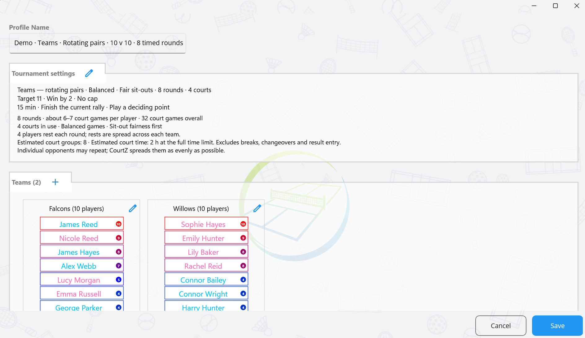
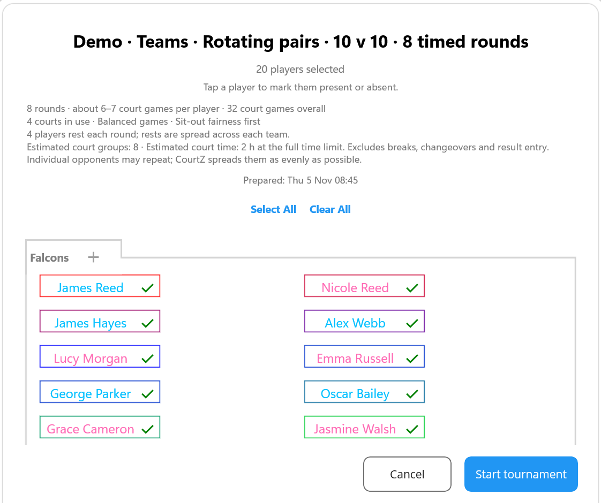
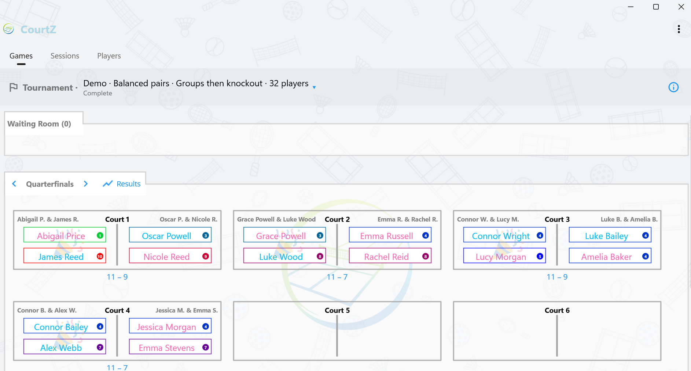
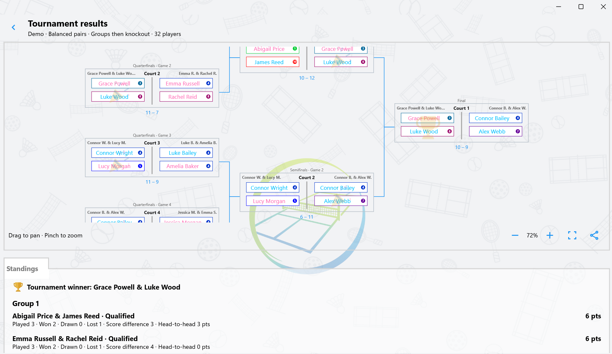

# Tournament Mode

## Create a tournament profile

1. Open **Sessions** and tap **+** beside **Tournaments**.
2. Name the profile and choose singles, fixed pairs or teams. For fixed pairs, add players to the tournament roster, then create pairs manually or use the shuffle button to choose random or skill-balanced pairs.
3. Choose round robin, knockout, double elimination, groups then knockout or Swiss. For two teams playing doubles with different partners each round, choose **Rotating pairs** as the team format.
4. Set the number of courts and the scoring rules. Choose winner-only results, a single score or best-of scoring. Set a time limit if needed and check the workload estimate before saving.

## Start and score the tournament

1. In **Games**, open the session selector and choose the tournament profile.
2. Confirm attendance and select **Start tournament**. You can also prepare attendance in advance from **Sessions**.
3. Use the round arrows to move between rounds or court groups. Tap **Result** under a court to enter the outcome. Tap a recorded score to correct it.
4. Use the information icon beside the tournament name to check the rules and scheduled rounds.

Changing an earlier result can affect later rounds in a format where the draw depends on results. CourtZ asks for confirmation before discarding affected results.

## Resume, review and share

Select the tournament profile again in **Games** to resume an event in progress or review a completed one. Tap **Results** in the round heading to open the draw and standings. Drag to pan, use the zoom controls or pinch on a touchscreen, and tap the share icon to share an image.

To move a saved tournament to another device, share or export its profile with [Share Configuration](09-configuration.md#sharing-a-configuration), then import it on the other device. The exported profile includes its latest saved event.
